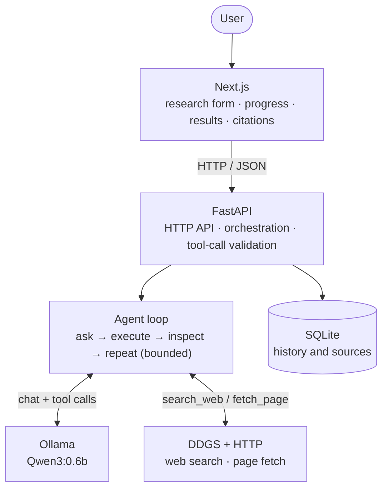
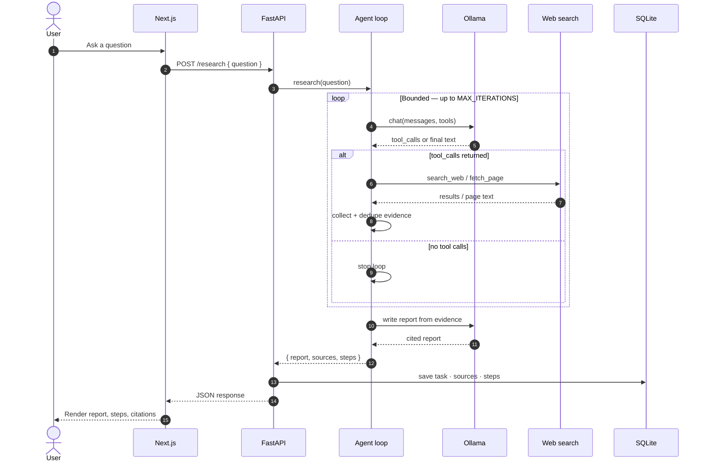
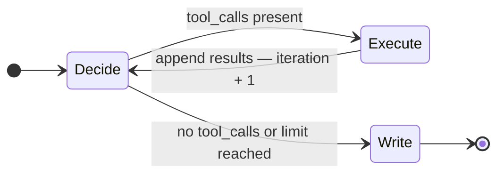

# Research Agent

An autonomous web-research agent. Ask a question, and the agent searches the
web, reads the pages it finds, and writes a concise report with numbered
citations you can verify.

- **Ask** a question in the browser.
- **Watch** the agent search and read sources.
- **Read** a cited report plus the full source list.

> **Status:** MVP — a working end-to-end demo. See the [Roadmap](#roadmap) for
> planned v2 features.

---

## Architecture

> **In one line:** a Next.js UI talks to a single FastAPI service that runs a
> **bounded, tool-calling agent** against a **local Ollama model**, using
> **DDGS** for web search and **SQLite** for history.

### System overview



### Request lifecycle



### Agent loop



### Component reference

| Layer | Technology | Responsibility | Talks to |
| --- | --- | --- | --- |
| **Interface** | Next.js 16 · React 19 | Research form, live progress, rendered report, citation/source list. | FastAPI |
| **API** | FastAPI · Uvicorn | Accepts requests, validates input, orchestrates the agent, persists results. | Agent loop · SQLite |
| **Agent** | Python loop | Asks the model, executes requested tools, inspects results, repeats within limits. | Ollama · DDGS · HTTP |
| **Model** | Ollama · `qwen3:0.6b` | Decides which tools to call and writes the final report. | Agent loop |
| **Search** | DDGS | Web search backend used by the `search_web` tool. | Agent loop |
| **Storage** | SQLite | Stores research history, sources, and agent steps. | FastAPI |

### Step by step

1. The user submits a question from the Next.js workspace.
2. The frontend `POST`s it to FastAPI's `/research` endpoint.
3. FastAPI starts the agent loop; on each iteration the model may request a tool
   call (`search_web` or `fetch_page`).
4. Tool results are fed back to the model until it stops requesting tools or the
   iteration limit is reached.
5. A final report is generated **from the gathered evidence only**, cited with
   numbered references that map to the returned source list.
6. FastAPI saves the task, sources, and steps to SQLite and returns the result.
7. The frontend renders the agent steps, the cited report, and the sources.

<details>
<summary>Plain-text diagram (for renderers without Mermaid)</summary>

```text
        User
         │
         ▼
     Next.js ──HTTP/JSON──▶ FastAPI ──▶ Agent loop ──▶ Ollama · Qwen3:0.6b
                              │              │
                              │              └──▶ DDGS (web search) + page fetch
                              ▼
                          SQLite (history + sources)
```

</details>

---

## Tech stack

- **Frontend:** Next.js 16 (App Router), React 19, Tailwind CSS v4, TypeScript.
- **Backend:** FastAPI, Uvicorn, Pydantic.
- **Agent:** Ollama (`qwen3:0.6b`) with a bounded tool-calling loop.
- **Tools:** `ddgs` for web search, `httpx` + `beautifulsoup4` for page fetching.
- **Storage:** SQLite.

---

## Project structure

```
research-agent/
├── backend/
│   ├── main.py          # FastAPI app, CORS, /health and /research routes
│   ├── agent.py         # Bounded agent loop (model ⇄ tools) and final report
│   ├── llm.py           # Ollama chat wrapper and model config
│   ├── tools.py         # Tool definitions exposed to the model
│   ├── search.py        # search_web tool (DDGS)
│   ├── fetcher.py       # fetch_page tool (httpx + BeautifulSoup)
│   ├── database.py      # SQLite schema + persistence
│   ├── requirements.txt
│   └── Dockerfile
├── frontend/
│   ├── app/
│   │   ├── layout.tsx           # Unified shell: header, main, footer
│   │   ├── page.tsx             # Home / landing page
│   │   ├── not-found.tsx        # 404 page
│   │   ├── globals.css          # Tailwind + design tokens
│   │   ├── research/page.tsx    # Research workspace
│   │   ├── components/          # Header, footer, search box, report, sources, progress
│   │   └── lib/api.ts           # Typed API client for the backend
│   ├── next.config.ts
│   └── Dockerfile
├── docker-compose.yml
├── .env.example
└── Readme.md
```

---

## Getting started

### Option A — Docker Compose (recommended)

Runs Ollama, the backend, and the frontend together.

```bash
docker compose up --build
```

The first run downloads the `qwen3:0.6b` model via the `ollama-pull` service,
which can take a few minutes.

| Service | URL |
| --- | --- |
| Frontend | http://localhost:3000 |
| Backend API | http://localhost:8000 |
| API docs (Swagger) | http://localhost:8000/docs |
| Ollama | http://localhost:11434 |

To stop:

```bash
docker compose down          # keep data
docker compose down -v       # also remove the model + database volumes
```

### Option B — Local development

**Prerequisites:** Python 3.11+, Node.js 20+, and a running
[Ollama](https://ollama.com) server with the model pulled:

```bash
ollama pull qwen3:0.6b
```

**Backend**

```bash
cd backend
python -m venv .venv
source .venv/bin/activate        # Windows: .venv\Scripts\activate
pip install -r requirements.txt
uvicorn main:app --reload
```

**Frontend** (in a second terminal)

```bash
cd frontend
npm install
npm run dev
```

Open http://localhost:3000.

---

## Configuration

Copy `.env.example` to `.env` and adjust as needed.

| Variable | Service | Default | Description |
| --- | --- | --- | --- |
| `OLLAMA_HOST` | backend | `http://localhost:11434` | Ollama server the agent talks to. |
| `CORS_ORIGINS` | backend | `http://localhost:3000,http://127.0.0.1:3000` | Comma-separated origins allowed to call the API. |
| `DB_PATH` | backend | `research.db` | SQLite database path. |
| `NEXT_PUBLIC_API_URL` | frontend | `http://localhost:8000` | Base URL the **browser** uses for the API. Inlined at build time. |

> `NEXT_PUBLIC_*` variables are baked into the client bundle during
> `next build`. When using Docker, pass it as a build arg (already wired in
> `docker-compose.yml`).

---

## API reference

### `GET /health`

Returns `{ "status": "ok" }`.

### `POST /research`

Runs a research task.

**Request**

```json
{ "question": "How do retrieval-augmented agents reduce hallucinations?" }
```

`question` must be between 3 and 500 characters.

**Response**

```json
{
  "task_id": 1,
  "question": "How do retrieval-augmented agents reduce hallucinations?",
  "report": "Retrieval-augmented generation grounds answers in retrieved evidence [1] …",
  "sources": [
    { "title": "…", "url": "https://…", "snippet": "…" }
  ],
  "steps": [
    { "iteration": 1, "tool": "search_web", "arguments": { "query": "…" } }
  ]
}
```

---

## Notes & limitations

- The agent loop is bounded by `MAX_ITERATIONS` (`agent.py`) to control cost and
  latency.
- Page content is treated as untrusted evidence, never as instructions.
- `fetch_page` currently performs basic URL validation only; add SSRF
  protections (block private IPs, validate redirects, cap response size) before
  exposing it publicly.
- The bundled model (`qwen3:0.6b`) is small and fast. Swap `MODEL` in `llm.py`
  for a larger model for higher-quality answers.

---

## Roadmap

This project is an **MVP**: it proves the end-to-end flow (question → web search
→ cited report) as a single-user demo. The items below are planned for **v2**
and beyond.

| # | Feature | Why it matters |
| --- | --- | --- |
| 1 | **Authentication & accounts** | OAuth/email sign-in, per-user research history, and scoped API keys. |
| 2 | **Async jobs + live streaming** | Run research in the background and stream agent steps token-by-token over SSE/WebSockets instead of waiting on one blocking request. |
| 3 | **Multi-provider models** | Choose Ollama, OpenAI, Anthropic, or a hosted endpoint per user, with fallbacks. |
| 4 | **Vector search & caching** | Embed sources, deduplicate/cache page fetches, and reuse prior research across related questions. |
| 5 | **Saved reports & export** | Save, organize, and export reports to Markdown/PDF, plus shareable read-only links. |
| 6 | **Rate limiting & cost controls** | Per-user quotas, usage metering, and spend limits for public deployments. |
| 7 | **Observability & evaluation** | Tracing, metrics, and an evaluation harness that scores citation accuracy and answer quality. |

> Have an idea? Open an issue to propose a feature or reorder the roadmap.
